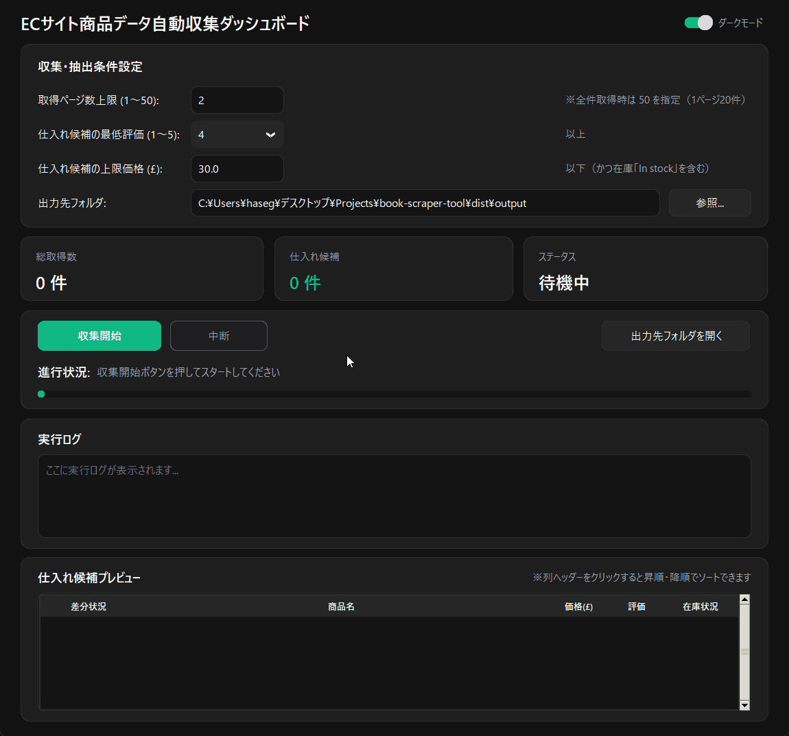

# ECサイト商品データ自動収集＆条件抽出ツール (book-scraper-tool)

対象ECサイト（[Books to Scrape](https://books.toscrape.com/)）から商品データを自動収集し、前回データとの価格変動・新着差分および指定条件に合致する「仕入れ候補リスト」をプレビュー表示＆Excelファイル（`.xlsx`）へ自動出力するWindows向けデスクトップアプリケーションです。



---

## 主な機能

- **Webスクレイピング自動収集**
  - 指定したページ数（1〜最大50ページ、最大1,000件）を巡回し、各商品の「商品名 (`title`)」「価格 (`price`)」「在庫状況 (`stock`)」「評価 (`rating`: 1〜5)」「商品詳細URL (`url`)」を抽出します。
  - サーバー負荷対策として1ページごとに1秒のウェイト（`time.sleep(1.0)`）を挿入。
  - 通信エラー・タイムアウト時は最大3回まで自動リトライし、異常時は安全に停止するエラーハンドリングを搭載。
- **前回データとの差分検出機能 (`last_scrape.json`)**
  - 収集データを `last_scrape.json` に自動保存し、次回実行時に商品URLをキーとして前回価格と比較した差分状況（`status_diff` 列）を自動付与します。
  - 判定ステータス：`初回取得` / `NEW` / `値下がり (-£X.XX)` / `値上がり (+£X.XX)` / `変動なし`
- **条件抽出＆Excel 2シート出力**
  - 取得した全データを収録する **`全商品一覧`** シートと、指定条件（最低評価・上限価格・在庫あり `"In stock"`）を満たす商品のみを抽出した **`仕入れ候補`** シートの2シート構成（ともに `status_diff` 列付き）で `.xlsx` ファイルを生成します。
- **モダンなダッシュボードGUI (`customtkinter` + `ttk.Treeview`)**
  - **設定自動保存＆インライン検証**: 取得ページ数上限・最低評価・上限価格・出力先フォルダをすべて `config.json` に保存し次回起動時に復元。入力ミス時は入力欄を赤枠でハイライトしてステータス欄に理由を表示します。
  - **リアルタイムKPI＆残り時間表示**: 総取得数・仕入れ候補数・ステータスをKPIカードでリアルタイム集計し、経過時間から算出した「残り約 ○ 秒」の目安を進捗バーとともに表示します。
  - **色分け実行ログ**: プレースホルダー付きのログエリアに、通常（白）・完了/値下がり（緑）・警告/中断（黄）・エラー（赤）を色分け表示します。
  - **仕入れ候補プレビュー表（ソート対応）**: 収集完了後、画面下部のテーブル（`差分状況` / `商品名` / `価格(£)` / `評価` / `在庫状況`）に仕入れ候補を即座に一覧表示し、列ヘッダークリックで昇順・降順ソートが可能です。

---

## 技術スタック

- **言語**: Python 3
- **通信・HTML解析**: `requests`, `beautifulsoup4`
- **データ処理・Excel出力**: `pandas`, `openpyxl`
- **GUI**: `customtkinter`（tkinterベース）
- **実行ファイル化**: `PyInstaller`

---

## ファイル構成

```text
book-scraper-tool/
├── scraper.py         # スクレイピング・差分検出・データ抽出・Excel出力コアモジュール
├── gui.py             # CustomTkinterデスクトップGUIアプリケーション
├── SPEC.md            # 要件・仕様書
├── requirements.txt   # 依存パッケージ一覧
└── README.md          # 本ドキュメント
```

---

## 開発環境での実行手順

### 1. リポジトリのクローンと仮想環境の準備

```powershell
git clone https://github.com/<your-username>/book-scraper-tool.git
cd book-scraper-tool

python -m venv .venv
.\.venv\Scripts\Activate.ps1
pip install -r requirements.txt
```

### 2. GUIアプリケーションの起動

```powershell
python gui.py
```

### 3. コアモジュール単体でのテスト実行（CLI・2ページ分）

```powershell
python scraper.py
```

### 4. スタンドアロン実行ファイル（`.exe`）のビルド手順

`PyInstaller` を使用して、Python環境のないWindows環境でも動作する単一実行ファイルを生成できます。

```powershell
pip install pyinstaller
pyinstaller --onefile --noconsole --collect-all customtkinter --name "EC商品データ自動収集ツール" gui.py
```

ビルド完了後、`dist/EC商品データ自動収集ツール.exe` が出力されます。
